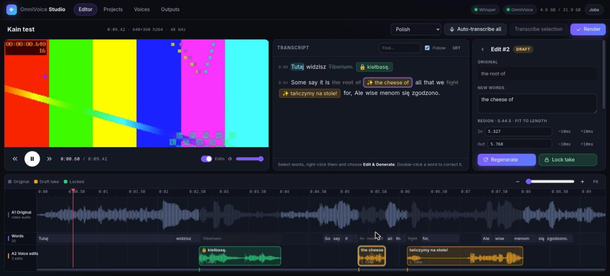

# Voice-Clone
> Easy voice cloner implementation for [OmniVoice](https://github.com/k2-fsa/OmniVoice), with a transcript-driven **Voice Edit Studio** web UI.

[](LICENSE)


---

# Contents
- `studio/` - **Voice Edit Studio**: web UI to edit what people say in a video or audio file
- `cli.py` - Main CLI interface for OmniVoice
- `whisper.py` & `whisper2.py` - Transcription with whisper model.
- `voices/*` - Voices i cloned for OmniVoice (shared by the CLI and the studio)
- `setup-studio.sh`, `requirements-studio.txt` - studio environment setup

---

# Voice Edit Studio



Load a video or audio file, transcribe it, select words, right-click **✨ Edit & Generate**,
type what should be said instead, and the new words are spoken in the same voice, right in
place, on a second audio track. Preview, regenerate as often as you like, lock the take you
want, then render. Meme edits in seconds.

**Editor**
- Video/audio player with a canvas timeline: ruler, original waveform (A1), word lane, and the
  voice-edit track (A2) showing each take's waveform. Ctrl+wheel zooms, wheel scrolls.
- **Auto-transcribe all** or just a selected range (Whisper large-v3-turbo, word timestamps).
- Correct the transcript yourself: double-click a word to retype it, drag word edges on the
  timeline to fix timing, or select a range and type its transcript.
- Select words (drag in the transcript or on the timeline) → right-click → **Edit & Generate**:
  - the voice is cloned from the surrounding words of the same file (or pick a library voice),
  - *Fit to original* forces the new words into the original duration (default), *Natural* lets
    them run at their own length,
  - cut points snap to the quietest spot nearby and get short crossfades, and the take is
    loudness-matched to the words it replaces.
- Every generation is a new **take**. Click a take to make it active, play it alone, hear it
  **in context** (server-mixed with the same mixer as the final render), regenerate, or 🔒 lock it.
  Each take is checked with Whisper, so the inspector shows what was actually said
  (`✓ heard: …` / `⚠ heard: …`).
- Nothing blocks while the GPU works: Regenerate, Edit & Generate, Quick TTS and voice clones
  go into a queue of up to **10 jobs** and run one after another (the Jobs menu shows each
  job's place in the queue).
- Live A/B: with **Edits** on, playback ducks the original and plays the takes in place.
- **Render**: locked takes only, or everything; the video stream is copied without re-encoding
  and only the audio track is replaced. SRT export of the corrected transcript.

**Library**
- **Projects**: every imported file with its transcript, edits and takes.
- **Voices**: the `voices/*.pt` prompts (same format as `cli.py`). Clone new voices from a file, or
  select speech in the editor → right-click → *Save voice to library*. Rename, download, delete.
- **Quick TTS**: any library voice, auto voice, or voice design (`instruct`) → `outputs/`.
- **Outputs**: play, download and delete renders and TTS samples.

## Setup

Put the files into an OmniVoice checkout (as for the CLI), then build the studio venv:

```bash
git clone https://github.com/k2-fsa/OmniVoice
git clone https://github.com/Szmelc-INC/Voice-Clone
mv Voice-Clone/* OmniVoice/ && rm -fr Voice-Clone && cd OmniVoice
./setup-studio.sh            # creates .venv-studio
```

`setup-studio.sh` creates a [uv](https://github.com/astral-sh/uv) venv with
`--system-site-packages`, so it **reuses the system torch** (for example Arch's
`python-pytorch-rocm` on an AMD card). It pins `transformers>=5.3,<6` and `huggingface-hub<2`,
then **removes the CUDA torch/nvidia wheels the resolver pulls in**, because they would shadow
the system build. It also installs OmniVoice in editable mode without dependencies.

Already have a working OmniVoice environment? Just add the studio packages:
`pip install fastapi uvicorn python-multipart soundfile librosa`.

## Run

```bash
.venv-studio/bin/python -m studio --open          # http://127.0.0.1:7860
.venv-studio/bin/python -m studio --preload       # load Whisper + OmniVoice at startup
```

| Option | Default | |
| --- | --- | --- |
| `--host` / `--port` | `127.0.0.1` / `7860` | bind address |
| `--data` | `./studio_data` | projects, media copies, takes (`OMNIVOICE_STUDIO_DATA`) |
| `--voices` | `./voices` | voice library (`OMNIVOICE_VOICES_DIR`) |
| `--outputs` | `./outputs` | renders and TTS (`OMNIVOICE_OUTPUT_DIR`) |
| `OMNIVOICE_DEVICE` | `cuda:0` | torch device (ROCm also shows up as `cuda`) |

Models load on first use (a few seconds each when they are in the Hugging Face cache) and stay
resident. All model work runs on a single GPU worker, and imports and renders run on a separate
CPU worker.

Notes:
- No `HSA_OVERRIDE_GFX_VERSION` is needed on RDNA4 with ROCm 7 (gfx1201 is native).
- The studio hides a broken system `torchvision` from transformers. Set
  `OMNIVOICE_STUDIO_TORCHVISION=1` if you need it.
- Media that browsers cannot play (for example HEVC in MKV) gets an H.264 preview proxy. The
  render still uses the original video stream.

## Keyboard

`Space` play/pause · `E` Edit & Generate · `P` play selection / preview edit · `G` regenerate ·
`L` lock/unlock · `Z` zoom to selection · `←/→` seek 1 s (`Shift` 5 s) · `+/-` zoom ·
`Delete` delete edit · `Esc` clear selection

## API

The UI talks to a small REST API (`/api/projects`, `/api/projects/{id}/edits`, `/api/voices`,
`/api/outputs`, `/api/tts`, `/api/jobs/{id}`), so edits can also be scripted. See
`studio/server.py`. Interactive docs are at `/docs`.

---

# CLI usage

1. Start python env
2. Run `python cli.py` in terminal
3. Select 1 to clone voice (provide voice sample + transcript txt)
4. Select 2 to synthesize speech using cloned voice
